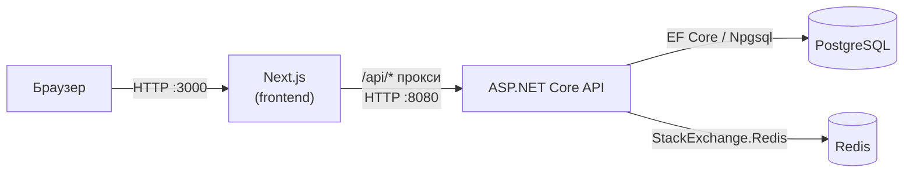
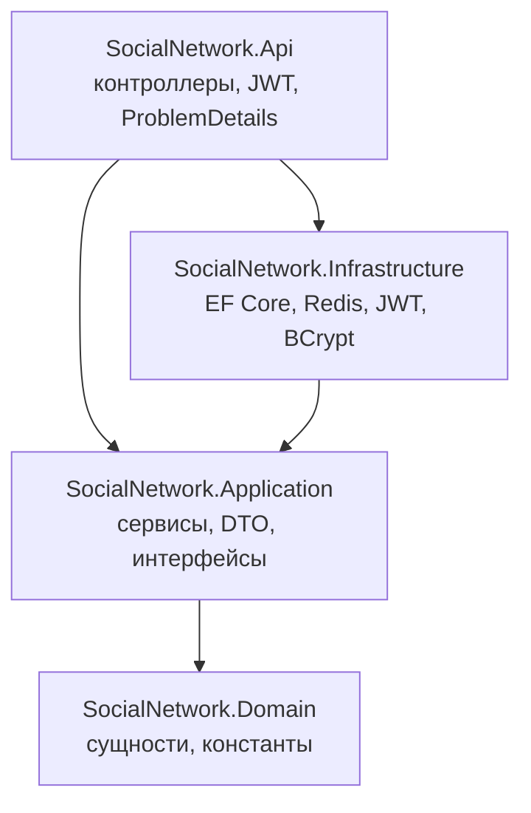

# Архитектура

## Общая схема

Браузер обращается только к Next.js. Все запросы `/api/*` обрабатывает route handler
`frontend/src/app/api/[...path]/route.ts`, который пересылает их в API (адрес — переменная
`API_INTERNAL_URL`, читается в рантайме). Благодаря этому фронтенд и API находятся на одном origin
и CORS для браузера не нужен; CORS в API настроен только для прямых обращений при разработке.

## Бэкенд: Clean Architecture

Правило зависимостей: внутренние слои ничего не знают о внешних.

| Слой | Ответственность |
|---|---|
| **Domain** | Сущности (`User`, `Role`, `UserRole`, `RefreshToken`, `Post`), `BaseEntity`, имена ролей `RoleNames`. Не зависит ни от чего. |
| **Application** | Прикладные сервисы (`AuthService`, `UserService`, `RoleService`, `PostService`), DTO запросов/ответов с валидацией DataAnnotations, исключения (`NotFoundException`, `ForbiddenException`, …) и интерфейсы-порты: `IApplicationDbContext`, `ITokenService`, `IPasswordHasher`, `ICacheService`, `ICurrentUserService`. |
| **Infrastructure** | Реализации портов: `ApplicationDbContext` (PostgreSQL), конфигурации сущностей, миграции, `DbInitializer` (миграции + начальные данные), `TokenService` (JWT, refresh-токены), `BCryptPasswordHasher`, `RedisCacheService`. |
| **Api** | Контроллеры, настройка аутентификации JWT Bearer, `CurrentUserService` (данные из `HttpContext`), `AppExceptionHandler` — преобразует исключения Application в ответы RFC 7807. |

Слой Application работает с БД через `IApplicationDbContext` (набор `DbSet<>`), а не через
репозитории: EF Core уже реализует паттерны Repository и Unit of Work.

### Обработка запроса

1. Контроллер (Api) получает запрос; `[ApiController]` автоматически валидирует DTO → 400 ProblemDetails.
2. `[Authorize]` / `[Authorize(Roles = ...)]` проверяет JWT и роли.
3. Контроллер вызывает сервис Application.
4. Сервис выполняет бизнес-проверки, при нарушении бросает исключение (`ConflictException` и т.д.).
5. `AppExceptionHandler` переводит исключение в HTTP-статус: 404 / 409 / 401 / 403 / 400.

### Кэширование

`UserService.GetByIdAsync` использует схему cache-aside: профиль ищется в Redis по ключу
`socialnetwork:user:{id}` (TTL 10 мин), при промахе — читается из БД и кладётся в кэш.
Любое изменение пользователя (профиль, роли, блокировка) удаляет ключ.
`RedisCacheService` не пробрасывает ошибки Redis: при недоступности кэша данные читаются из БД.

## Фронтенд

| Путь | Назначение |
|---|---|
| `src/lib/api.ts` | `fetch`-обёртка: подставляет access-токен, при 401 один раз обновляет пару токенов и повторяет запрос |
| `src/lib/auth-context.tsx` | `AuthProvider` / `useAuth()`: текущий пользователь, вход, регистрация, выход, `hasRole()` |
| `src/components/RequireAuth.tsx` | Клиентская защита страниц (редирект на `/login`, проверка ролей) |
| `src/app/*` | Страницы: лента `/`, `/login`, `/register`, `/profile`, `/users`, `/users/[id]`, `/admin` |

Токены хранятся в `localStorage`. Проверки ролей на фронтенде — только для UI;
реальное разграничение доступа выполняет API.
