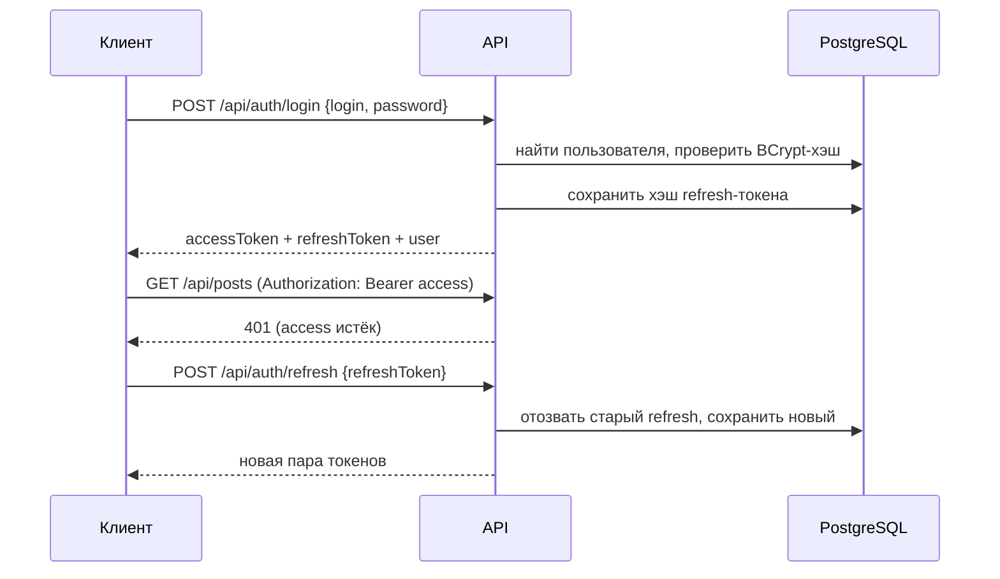

# Авторизация и роли

## Токены

| Токен | Формат | Срок жизни | Где хранится |
|---|---|---|---|
| Access | JWT, HMAC-SHA256 | 15 мин (`Jwt:AccessTokenMinutes`) | клиент |
| Refresh | 64 случайных байта, Base64 | 7 дней (`Jwt:RefreshTokenDays`) | клиент; в БД — только SHA-256 хэш |

Claims access-токена: `sub` (id пользователя), `email`, `unique_name`, `jti`, `role` (по одному на роль).
API отключает переименование claims (`MapInboundClaims = false`) и использует `sub`/`role` как
`NameClaimType`/`RoleClaimType`.

Пароли хэшируются BCrypt (enhanced, work factor 11).

## Сценарии

- **Регистрация** — пользователь получает роль `User`, сразу выдаётся пара токенов.
- **Обновление** — ротация: старый refresh-токен отзывается, повторно использовать его нельзя.
- **Выход** — refresh-токен отзывается; access-токен остаётся валидным до истечения срока.
- **Блокировка** — вход и обновление запрещены (403), все refresh-токены отзываются.

## Роли

| Роль | Описание |
|---|---|
| `User` | Базовая роль каждого пользователя, отозвать нельзя |
| `Moderator` | Модерация контента и пользователей |
| `Admin` | Полный доступ, управление ролями |

Роли хранятся в таблицах `roles` и `user_roles` (многие-ко-многим, с полями `AssignedAt` и
`AssignedById`). Системные роли и первый администратор (секция `SeedAdmin`) создаются
`DbInitializer` при старте.

### Матрица доступа

| Действие | User | Moderator | Admin |
|---|:-:|:-:|:-:|
| Просмотр ленты, профилей, поиск | ✓ | ✓ | ✓ |
| Создание постов, редактирование своего профиля | ✓ | ✓ | ✓ |
| Удаление своих постов | ✓ | ✓ | ✓ |
| Удаление чужих постов | | ✓ | ✓ |
| Блокировка / разблокировка пользователей (кроме Admin) | | ✓ | ✓ |
| Просмотр ролей, назначение и отзыв ролей | | | ✓ |

Ограничения при управлении ролями: нельзя отозвать `User`; нельзя отозвать `Admin` у самого себя.

### Важно

Роли записываются в access-токен при его выдаче. После изменения ролей пользователь получит
новые права при следующем обновлении токена (не позднее 15 минут) или повторном входе.
