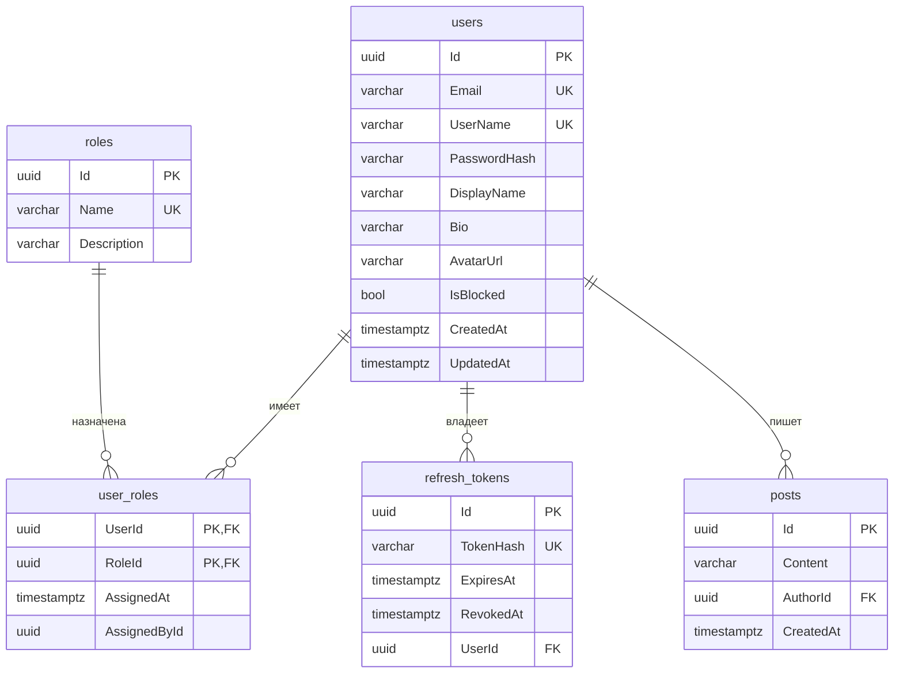

# База данных

PostgreSQL 17. Схема создаётся миграциями EF Core
(`backend/src/SocialNetwork.Infrastructure/Persistence/Migrations`), которые применяются
автоматически при старте API (`DbInitializer`).

## ER-диаграмма



Все внешние ключи — `ON DELETE CASCADE`. Email и имя пользователя хранятся в нижнем регистре.

## Миграции

Команды выполняются из каталога `backend/` (инструмент `dotnet-ef` подключён локально через
`dotnet-tools.json`, перед первым использованием — `dotnet tool restore`):

```bash
# создать миграцию после изменения сущностей/конфигураций
dotnet ef migrations add <Name> -p src/SocialNetwork.Infrastructure -s src/SocialNetwork.Api -o Persistence/Migrations

# применить вручную (обычно не требуется — применяются при старте API)
dotnet ef database update -p src/SocialNetwork.Infrastructure -s src/SocialNetwork.Api

# SQL-скрипт для приложения к отчёту
dotnet ef migrations script -p src/SocialNetwork.Infrastructure -s src/SocialNetwork.Api
```

## Redis

| Ключ | Значение | TTL |
|---|---|---|
| `socialnetwork:user:{id}` | `UserDto` в JSON | 10 мин |
